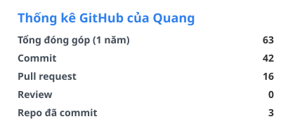

<h1 align="left" id="quangnx-title">:wave: Xin chào! Mình là Nguyễn Xuân Quang</h1>
<h3 align="left">Backend developer · .NET microservices · commerce & logistics · AI-assisted delivery</h3>

<p align="left">
  <a href="https://github.com/quangnxicb"></a>
  <a href="https://github.com/quangnxicb?tab=followers"></a>
</p>

<a href="#quangnx-title"></a>

- :office: &nbsp;Đang làm tại **ICHIBA**: nền tảng cross-border commerce (OMS, WMS, pricing, payment, loyalty)
- :seedling: &nbsp;Đang làm **30+ microservices** .NET: BFF, identity, notification, storage, CDC ingestion
- :robot: &nbsp;Dùng **Claude Code** để code, review và deploy song song
- :speech_balloon: &nbsp;Thích nói về **microservices**, **CQRS / saga**, **Kafka / RabbitMQ** và **K8s**
- :mailbox: &nbsp;Hỏi gì cứ mở **[issue]**

<br>

<h2 align="left" id="quangnx-tech">Công nghệ hay dùng</h2>

> Ngôn ngữ, công cụ và nền tảng mình làm việc hằng ngày.

<table>
  <tr>
    <td align="center" width="96">
      <a href="#quangnx-tech"></a>
      <br>C# / .NET
    </td>
    <td align="center" width="96">
      <a href="#quangnx-tech"></a>
      <br>SQL Server
    </td>
    <td align="center" width="96">
      <a href="#quangnx-tech"></a>
      <br>PostgreSQL
    </td>
    <td align="center" width="96">
      <a href="#quangnx-tech"></a>
      <br>Redis
    </td>
    <td align="center" width="96">
      <a href="#quangnx-tech"></a>
      <br>RabbitMQ
    </td>
    <td align="center" width="96">
      <a href="#quangnx-tech"></a>
      <br>Kafka
    </td>
    <td align="center" width="96">
      <a href="#quangnx-tech"></a>
      <br>Kubernetes
    </td>
    <td align="center" width="96">
      <a href="#quangnx-tech"></a>
      <br>Actions
    </td>
  </tr>
</table>

<h2 align="left">Coding Activity</h2>

> Tổng đóng góp GitHub tích luỹ trong 7 ngày gần nhất (commit, PR, review; gồm cả repo riêng tư). Cập nhật mỗi giờ.

<!-- prettier-ignore-start -->
<!-- START_SECTION:ascii_graph -->

```
56 đóng góp ┤                                                                                                 ╭──
52 đóng góp ┤                                                                                                 │  
48 đóng góp ┤                                                                                                 │  
44 đóng góp ┤                                                                                                 │  
40 đóng góp ┤                                                                                                 │  
36 đóng góp ┤                                                                                                 │  
31 đóng góp ┤                                                                                                 │  
27 đóng góp ┤                                                                                                 │  
23 đóng góp ┤                                                                                                 │  
19 đóng góp ┤                                                                                                 │  
15 đóng góp ┤                                                                                                 │  
11 đóng góp ┼─────────────────────────────────────────────────────────────────────────────────────────────────╯  
            ┼─────────────┬─────────────┬─────────────┬─────────────┬─────────────┬─────────────┬─────────────┬─┤
           -7d           -6d           -5d           -4d           -3d           -2d           -1d           now
```

<sub>Cập nhật 27/11/2026 10:18 (GMT+7)</sub>

<!-- END_SECTION:ascii_graph -->
<!-- prettier-ignore-end -->

<h2 align="left">Hoạt động</h2>

> Đóng góp trên GitHub (gồm cả repo riêng tư), tự cập nhật.

<p align="left">
  
</p>

<!-- links -->

[issue]: https://github.com/quangnxicb/quangnxicb/issues "quangnxicb/issues"
